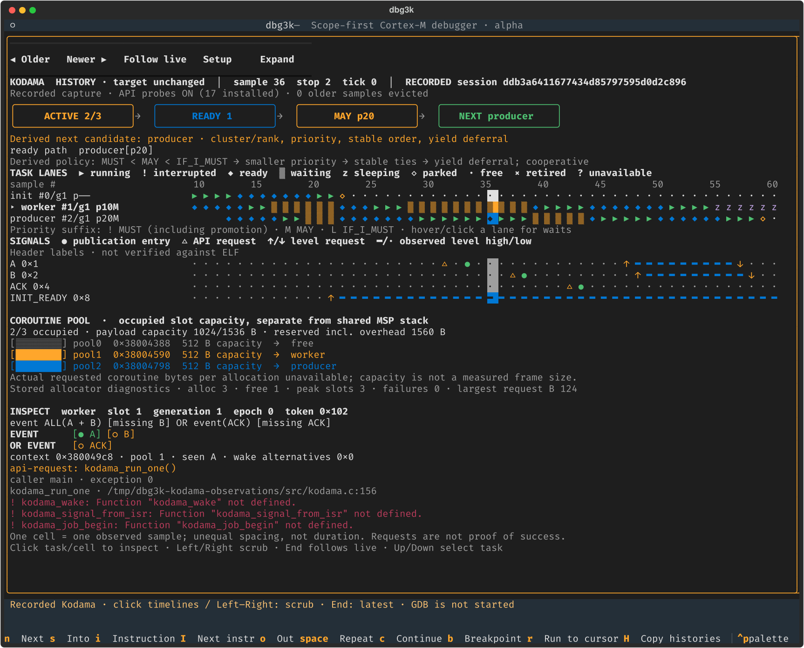

# Graphical Kodama state and timelines

The Kodama pane spans the terminal below the source/scope workspace, like the
GDB console. It opens automatically for an ELF containing kodama_run_one,
including the configuration-tagged ABI. Existing debugger panes stay selectable.
Use Ctrl+P → View: Kodama graphical scheduler and timelines, or Kodama expanded
view for more room. Left/Right palette toggles still work.

The image is from the real pinned teaching example. It shows a worker after A
arrived and a derived dispatcher candidate. Header names are source mappings.
Horizontal spacing represents observation order, not elapsed time.

## Launch and navigate

For continuous one-second repeats instead of a finite program exit, use the
[live superloop example](../examples/kodama-live/README.md). It builds a separate
live.elf and runs the real tasks with a QEMU SysTick timebase.

    dbg3k /path/to/demo.elf --kodama \
      --kodama-header /path/to/examples/c-main/task_config.hpp \
      --remote localhost:1234

The teaching task_config.hpp is discovered through DWARF when readable. For
other applications, select the signal header in Kodama setup. The bounded parser
accepts single-bit const/constexpr, enum and object-like macro definitions with
literals, named constants, shifts, OR and addition. It never executes the header
or runs a compiler. Unsupported definitions are reported; unnamed observed bits
appear as bitN. Source fingerprints are recorded, but current header text is
explicitly NOT verified against the ELF. Keep source and build matched.

- Click a task lane for identity, priority, wait alternatives, seen bits, wake
  mask, source location and pool binding. Filled/hollow condition chips identify
  observed and missing inputs.
- Click a cell to inspect that sample without executing firmware. New samples
  continue recording while the inspection stays put.
- Click a signal lane/cell for its persistent level and retained publication
  count/last sample/tick through the cursor.
- Left/Right scrub when the canvas has focus; Up/Down select tasks. End or
  Follow live follows the newest observed sample again.
- The horizontal **History** scrollbar stays above the scrolling content and
  pans task and signal lanes together. Drag its thumb or click its track to
  page through retained samples. Task/signal names stay fixed on the left.
  Page Up/Down page through history; Home selects the oldest retained sample.
  The range label shows the visible and retained sample numbers. Browsing holds
  the inspected window as new samples arrive; End or Follow live resumes following.
  If the selected sample is evicted, inspection advances to the oldest retained
  sample. The bar covers the existing512-sample UI retention, not all older
  records in the JSONL journal. It is available in both normal and expanded views.
- Expand opens a larger canvas; Esc closes it. Scroll vertically for more
  tasks, conditions, pool slots and diagnostics. Glyphs work without color;
  theme colors and the terminal's NO_COLOR preference are respected.

Setup Start / restart begins a fresh observation segment. Pause capture applies
at a halted stop; running firmware is not silently interrupted. The pane reports
pending changes. Hiding the pane leaves collection running. --no-kodama disables
automatic startup; --kodama-no-probes collects only manual-stop snapshots.
General Observation capture remains independent.

## Read the graphics

Lanes show running, interrupted, ready, waiting, sleeping, parked, free, retired
or unavailable state. Labels include slot, generation, priority and effective
cluster (! MUST, M MAY, L IF_I_MUST). Both packed identity and older separate
active/generation layouts are supported. Inactive slots do not inherit stale
waits/readiness. Generation regressions start a new identity epoch (eN), rather
than joining histories across an observed reset/discontinuity. Entirely missed
resets cannot be detected reliably: restart capture for a new run.

Scheduler boxes explain the known cooperative policy: active/ready candidates,
effective cluster and promotion, numeric priority, stable list order, yield
deferral/fallback. Running, destruction and observed exception contexts defer
thread-mode dispatch. Derived next candidates require consistent available fields
and list order. Incomplete/transitional state stays unknown. Interrupts and later
application actions can change eligibility; the projection is not a prediction
of guaranteed execution or an exact invocation trace.

Signal rows combine two separate namespaces. A filled dot is an observed entry
to internal signal_locked with its actual occurrence argument; zero-occurrence
level reevaluation creates no occurrence marker. A triangle is an API request
that can fail; paired `△↑`/`△↓` markers are level-high/level-low requests (`△?`
when the requested direction is unavailable). Both symbols occupy the same sample
cell; subsequent waveform cells show observed values. Solid/dotted cells are observed
persistent level high/low values. Occurrences have no persistent global on/off
state. Request/publication-entry markers are not completion/success records.

Optional internal entry probes collect samples between user stops for dispatch,
signals, pend/yield, timers and allocation/free. Compiled-out/stripped/unavailable
functions appear in coverage diagnostics. Caller, exception number, arguments
and source remain inspectable. An ISR-origin argument is separate from a hardware
exception. Real application qualification here is thread-mode; exception display
has model tests, not physical IRQ qualification. Each cell is ONE sample. Logical
ticks repeat/wrap; no MCU duration, occupancy, latency, power or unobserved
transitions are inferred from spacing or host timestamps.

## Pool ownership and memory

The map reads g_frames, g_cmd and task token/context fields. Ownership requires
a live task token/context, command binding and handle agreeing on the allocator
data address. Pending construction/destruction, stale/ambiguous bindings and
unsupported handle layouts stay unknown. Supported ARM/GCC frames use a bounded
read of live allocator storage to resolve a compiler actor symbol for task names.

Occupied payload CAPACITY, total payload capacity, slot extent and whole reserved
pool bytes are distinct. Reservation includes occupancy/alignment overhead.
Requested bytes for each allocation are unavailable: occupied 512 B capacity
does not prove a 512 B coroutine frame. Stored allocation/free/peak/failure/largest
request diagnostics appear when compiled in. Pool bytes are not added again as
per-task stacks; the shared MSP stack remains in existing stack views.

## Save and replay a lesson

Raw records append to the existing dbg3k-history/ELF_YYYY-MM-DD.jsonl. Setup shows
the absolute path; --history-dir still changes it. Values stay local. Existing
session/hash/error/write-failure behavior remains.

    dbg3k /path/to/the/same/demo.elf --kodama-history /path/to/journal.jsonl
    # Optional: --kodama-session SESSION_UUID

Replay launches no GDB/QEMU. It requires matching ELF SHA256, separates sessions
and capture segments, rejects late older sessions/duplicate sequences, follows
growing files and buffers partial lines. The newest matching segment with actual
samples is selected by default. Labels are never borrowed across sessions.
Rotation/truncation rebuilds the projection.

## Evidence stream and bounds

Additive dbg3k.trace.v1 kinds: kodama_config (capture, options, header mapping/hash),
kodama_coverage (installed/unavailable probes), kodama_sample and kodama_diagnostic.
Old readers ignore them. A sample's data.schema is dbg3k.kodama.raw.v1 with capture
ID, sample_seq, origin, visible-stop anchor, thread/frame/exception, event and
observed state. API entries anchor to the PRECEDING visible stop; manual samples
identify the current stop. API probes do not advance visible stop IDs.

Scalar nodes retain GDB type, status and decimal integer or hex pointer strings
with an encoding tag. Core globals, task/subscription fields, bindings, occupancy
and allocator diagnostics remain observed data. Derived state labels, conditions,
policy explanations and ownership interpretation live in the independent model.
Read errors/unknowns never become successful zeros. See [TRACE_JSONL.md](TRACE_JSONL.md).

Bounds: 32 tasks, 64 pool slots, 16 alternatives/subscription, 4096 samples/capture,
128 KiB/sample. The UI retains 512 samples and at most 128 lifetime lanes,
preserving current slots; the journal retains earlier evidence. Headers are
bounded to128 KiB/64 labels/80-character names. Replay consumes bounded batches.
Truncation and failures are explicit. The sample cap stops reads/recording,
not already installed probe traps: pause/restart at a debugger stop to remove or
rearm them. Host breakpoints/reads add overhead and can affect interleavings.
No firmware instrumentation or target calls are added. API-entry coverage is
narrower than continuous tracing.

## Reproduce qualification

    DBG3K_QEMU_TEST=1 \
    DBG3K_KODAMA_ELF=/path/to/pinned/demo.elf \
    DBG3K_KODAMA_CURRENT_ELF=/path/to/current/demo.elf \
    DBG3K_KODAMA_RECEIPT=/tmp/kodama-view-receipt \
    PYTHONPATH=src python -m unittest discover -s tests -p test_qemu_kodama.py -v

The pinned revision/build is described in [OBSERVATIONS.md](OBSERVATIONS.md).
Current local sources are built to /tmp without changing them; source and ELF
hashes are in handoff/kodama-view-validation.json. Both real examples must reach
their normal PASS transcript with all frames reclaimed. Independent MI reads
check seen bits and mapped pool occupancy. CI always runs a public ARM protocol
fixture (explicitly NOT a replacement Kodama scheduler); real cross-repository
Kodama qualification requires optional KODAMA_READ_TOKEN. Model/headless tests
cover identity reuse/regression, retirement, ownership, priority/list policy,
unknowns, exception context, replay, actual mouse/keyboard and theme flows.
Actual terminal and physical hardware qualification remain separate.

### Readable activity and copying

Activity arguments show a task name and generation when a context or subscription
uniquely matches an active task in the selected sample. Addresses remain visible;
new or ambiguous subscriptions remain unresolved. Aliases do not prove ownership
at unobserved times. Long activity calls wrap beneath their own heading.

Use **Copy** or focus the canvas and press **Ctrl+C** to copy selected text;
without a selection this copies the whole rendered view. Textual sends clipboard
contents through the terminal clipboard mechanism; terminal support is required.
